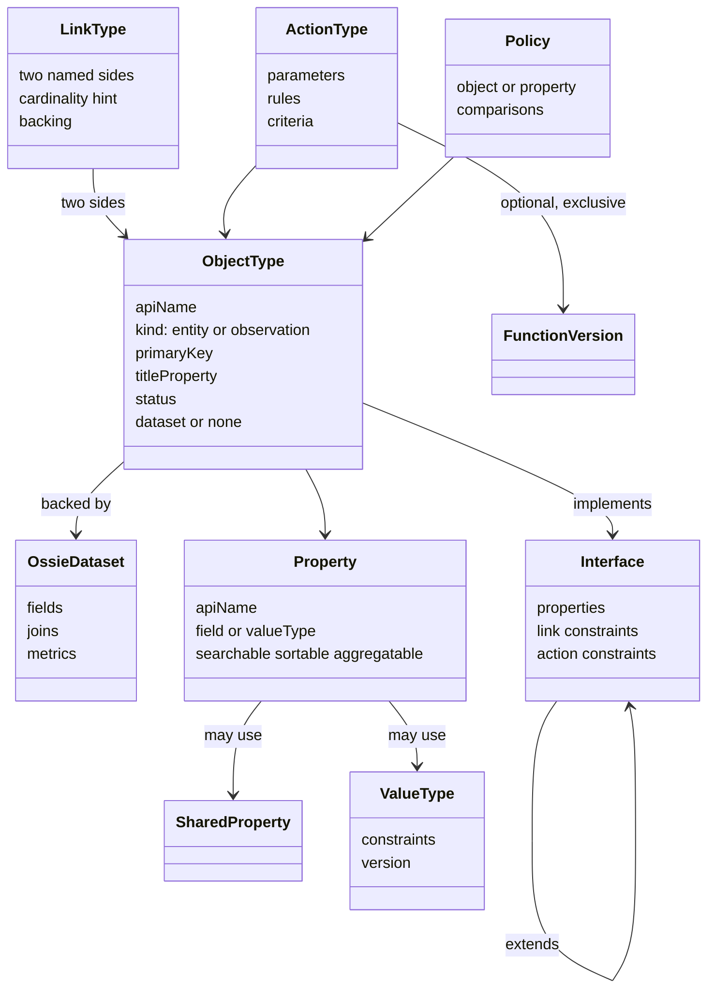
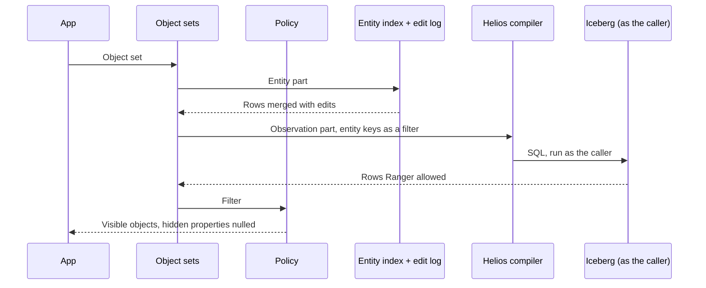
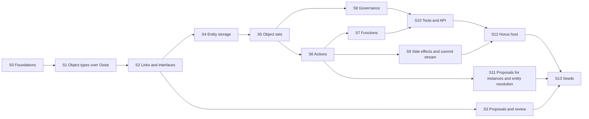

# Ontology plan: Helios semantic models plus an operational ontology

This plan merges two ideas into one stack:

- **Helios**, which builds reviewed semantic models of a warehouse (datasets, fields, joins, metrics) and answers questions through them, running every query as the person asking.
- **An operational ontology**: object types, links and interfaces that applications and agents read, plus a governed write path (actions and functions) and per-object security.

Helios already answers "what does this data mean, and how is this number computed?" The ontology adds "what things exist, how are they related, and who changed what?" Neither is complete alone. Together, they give Horus, and any other Helios host, one model that analysts, applications and LLM agents share.

Palantir Foundry's Ontology is a **reference** for the operational half: its documentation is precise about edge cases (rule order, what a function sees mid-edit, hidden objects versus nulled properties), and this plan borrows those semantics where they are good. It does not copy Foundry's products, screens or names, and it departs from Foundry wherever the Cloudera platform already does the job: Ranger for access control, Iceberg for history, Kafka and Flink for streams.

The work is expected to happen mostly in the Helios repo, with Horus as the first host. Which pieces belong in Helios and which in Horus is not settled; [Helios or Horus](#helios-or-horus) proposes a split and lists the boundaries still to decide.

Points are relative engineering weight, not calendar time. The plan is 14 sprints and 220 points.

## Contents

- [The layers](#the-layers)
- [Design rules](#design-rules)
- [Two kinds of object: entities and observations](#two-kinds-of-object-entities-and-observations)
- [Definition](#definition)
- [Read path](#read-path)
- [Write path](#write-path)
- [Governance](#governance)
- [Streams](#streams)
- [Proposals, review and entity resolution](#proposals-review-and-entity-resolution)
- [Serving: tools, API and applications](#serving-tools-api-and-applications)
- [Helios or Horus](#helios-or-horus)
- [Seeds](#seeds)
- [Sprints](#sprints)
- [After the core](#after-the-core)
- [What Helios has today](#what-helios-has-today)
- [References](#references)

## The layers

```mermaid
flowchart TB
  subgraph apps [Applications and agents]
    horusui[Horus map and object views]
    explorer[Object explorer]
    agents[LLM agents over MCP]
  end

  subgraph onto [Ontology: operational]
    types[Object types, links, interfaces]
    actions[Actions and functions]
    policies[Object and property policies]
    sets[Object sets]
  end

  subgraph sem [Semantic model: Helios / Ossie]
    datasets[Datasets, fields, joins]
    metrics[Metrics]
    review[Propose, review, publish]
  end

  subgraph phys [Physical]
    iceberg[Iceberg via Trino or Impala]
    stream[Kafka and Flink]
    graph[Memgraph]
    pg[Postgres: definition, edit log, entity index]
  end

  apps --> sets
  apps --> actions
  sets --> policies
  types --> datasets
  sets --> metrics
  datasets --> iceberg
  actions --> pg
  stream --> actions
  stream --> pg
  types --> graph
```

| Layer | Answers | Built from |
|---|---|---|
| Applications and agents | Show, explain, act | Horus UI, object explorer, MCP tools for Mistral, Prime Agent |
| Ontology | What things exist, how they relate, who may change or see them | This plan |
| Semantic model | What the data means; how a number is computed | Helios (Ossie format), proposed from the warehouse and reviewed by a person |
| Physical | Where the data is | Iceberg tables, Kafka topics, Postgres, Memgraph |

An object type does not point at a raw table. It points at an Ossie dataset, and its properties bind to Ossie fields. Ossie stays the place where columns get meaning and joins get verified; the ontology adds identity, links, edits and policy on top. Helios's README already says Ossie elements "map to ontology classes"; this plan makes that the architecture.

## Design rules

Later sprints must not break these.

1. **Actions are the only write path** for objects and links. A direct property update is an action with one modify rule, or it does not exist.
2. **Functions propose; actions apply.** A function that edits returns an edit batch. Running it in a test harness writes nothing. The action that names it writes, after its submission criteria pass.
3. **Inside an edit function**, a search or aggregation sees the index from before the batch; a fetch by primary key sees pending edits on that object. A test must fail if someone "fixes" this.
4. **Links change through their backing.** Foreign-key links change by editing the foreign-key property; many-to-many links by create-link and delete-link rules; object-backed links by creating or editing the backing object.
5. **Rules fold into one edit per object, in order.** On one property, the later rule wins. An object cannot be deleted and then written, modified and then created, or created twice in one submission. A function rule cannot sit beside other rules.
6. **Submission criteria are separate from the right to edit the action type.** A failure returns that criterion's message. Avoid `NOT` on group, marking or organisation membership: a scoped token can omit the attribute and the `NOT` would pass.
7. **Object policies hide; property policies null.** The primary key is never covered by a property policy. A non-key property belongs to at most one property policy, and an object policy exists before any property policy.
8. **Helios grants nothing.** Base rows are read as the caller, so the warehouse's own permissions (Ranger) decide. Ontology policies can only narrow what the warehouse allows, never widen it.
9. **Copies are grants.** Iceberg tables keep their Ranger policies wherever they are read. The entity index, a materialization or an export does not carry ontology policies, so each is a separate grant, and bulk export waits until markings exist.
10. **Observations are never copied into the entity index.** They are read where they live, through compiled SQL, and every observation query is bounded in time.
11. **Machines propose; people or criteria decide.** Anything a model, crawler or detection creates (an object type, a link, an identity match, an edit) carries a confidence and its evidence, and lands through review or through an action whose criteria accept it. This is Helios's "propose, don't decide" applied to instances.
12. **Layers only add leaves.** A domain pack imports the core; a customer extension imports a pack; neither redefines what it imports. This is the guarantee Helios's ontology layering already makes.
13. **Notifications render from the state before the edit and send after the commit.** A before-webhook that fails aborts the action; an after-webhook that fails is logged for retry and does not roll back.

## Two kinds of object: entities and observations

This is the main departure from the reference. Foundry indexes every object. Horus writes millions of position reports a day; indexing them would copy the lake into Postgres and lose Iceberg's history and Ranger's policies on the way.

| | Entity | Observation |
|---|---|---|
| Examples | Vessel, Aircraft, Organization, Port, Alert, Encounter, Person, Document | Position report, AIS static message, camera frame, weather reading |
| Volume | Thousands to millions | Millions per day |
| Stored | Entity index (Postgres) built from an Ossie dataset, plus the edit log | Only in its Ossie dataset (Iceberg) |
| Edits | Yes, through actions | No. Analysts annotate an observation by creating an entity (a Note, a Flag) linked to it |
| Read by | Index queries, merged with edits | SQL compiled by Helios, run as the caller |
| Required in a query | Nothing | A time bound |
| Links | Any backing | Foreign key to an entity (`positionReport.vessel`) |
| Aggregations | Over the index | Ossie metrics |

An object set can mix the two: "vessels flagged by an analyst, with their position reports in the last six hours" is a search-around from an entity set to an observation type, compiled to one SQL query with the entity keys as a filter.

Metrics bind to object types. `vessel.darkHours` is an Ossie metric over position reports, grouped by the vessel link. A metric can be shown on an object view, used as a filter, or called by an agent, and it is computed the same way everywhere because Helios compiles it.

## Definition

One definition, stored as YAML, versioned and reviewed like an Ossie model.



### Object types and properties

An object type has a display name, an API name, a description, a status (`experimental`, `active`, `deprecated`), a kind (`entity` or `observation`), one primary key and a title property. It is backed by one Ossie dataset, or by nothing when every object is created by an action.

A property binds to an Ossie field, or to nothing on an unbacked type. It has a base type or a value type, and the flags applications need: searchable, sortable, aggregatable. Shared properties (`displayName`, `firstSeen`, `confidence`) are defined once and used on many types; the metadata is shared, the values are not. Value types wrap a base type with constraints (regex, range, length, enum) and are versioned.

Base types the core honours:

| Base type | Primary key | Title | Notes |
|---|---|---|---|
| String, integer, short | Yes | Yes | Preferred primary keys |
| Date, timestamp | Discouraged | Yes | Prefer string keys |
| Boolean, byte, long | Discouraged | Yes | Long is awkward in JavaScript above 2^53 |
| Float, double, decimal | No | Yes | |
| Array of an allowed inner type | No | Only if the inner type can be a title | No null elements, no nested arrays |
| Geopoint | No | Yes | `latitude,longitude` |
| Geoshape | No | No | GeoJSON |

Reserved, implemented after the core: vector, struct, media reference, time series, attachment, cipher, marking.

### Link types

A link type is one relationship with two named sides: `vessel.positionReports` and `positionReport.vessel` are the two sides of one link type, not two link types. Side API names are unique per object type, start with a lowercase letter, and are at most 100 characters. Cardinality (`oneToOne`, `oneToMany`, `manyToOne`, `manyToMany`) is a hint; one-to-one is not enforced.

Backings:

- **Foreign key.** A property on one type holds the other's primary key. Editing the link edits the property. Where Helios has verified the join in the Ossie model, the link reuses it.
- **Join table.** One column per primary key, for many-to-many. The product can create an empty one when links will only come from actions.
- **Object-backed.** An intermediate object type points at both sides through many-to-one links and carries the relationship's own properties (an Affiliation with a role and dates; an identity match with a confidence and a reviewer).

Several link types may connect the same pair, and a type may link to itself.

### Interfaces

An interface is a shape (properties, link constraints, action constraints) with no data and no instances. Object types implement it; an interface can extend several others. A workflow written for `Actor` keeps working when a new type implements `Actor`, which matters in intelligence work, where new kinds of actor keep appearing. Interfaces are real in the definition, in object sets, in actions and in the generated tools.

### Layers and packs

The definition uses the layering Helios already applies to its LinkML ontology:

```text
core            shared properties, value types, base interfaces (Actor, Place, Evidence, Observable)
packs/osint     Person, Organization, Document, Claim, Source, Affiliation, SameAsAssertion ...
packs/maritime  Vessel, Port, PortCall, Encounter, PositionReport ...
packs/aviation  Aircraft, Airport, Flight ...
<host>          a customer's or a demo's own extension
```

Each layer only adds. The core is what Helios code is written against; a pack is what a domain shares; an extension is one deployment's.

### Branches, change sets and publishing

The definition lives in the Helios registry beside Ossie models: a draft branch, change sets that commit on save, an audit record per change (through Helios's `AuditSink`), and immutable published revisions with an activation log, the same mechanism Ossie models use today. Applications read the active revision of main.

Helios's existing LinkML ontology and `OntologyGraph` are stable contracts. They stay, and become a projection generated from the new definition: the graph Memgraph loads, and an OWL or JSON Schema export for anyone who wants one. Deprecation follows Helios's contract policy.

Illustrative fragment:

```yaml
space: horus
ontology: main
imports: [core, packs/maritime]
objectTypes:
  - apiName: vessel
    kind: entity
    displayName: Vessel
    primaryKey: vesselId
    titleProperty: displayName
    implements: [trackedAsset]
    dataset: { model: horus_lake, dataset: vessels }
    properties:
      - { apiName: vesselId, field: vessel_id }
      - { apiName: displayName, sharedProperty: displayName, field: name }
      - { apiName: mmsi, field: mmsi, valueType: mmsi }
      - { apiName: imo, field: imo, valueType: imo }
    metrics:
      - { apiName: darkHours, metric: horus_lake.vessel_dark_hours }
  - apiName: positionReport
    kind: observation
    primaryKey: eventId
    titleProperty: eventId
    dataset: { model: horus_lake, dataset: events_vessel_positions }
    timeProperty: capturedAt
    properties:
      - { apiName: eventId, field: event_id }
      - { apiName: capturedAt, field: captured_at }
      - { apiName: position, field: position, baseType: geopoint }
      - { apiName: vesselId, field: vessel_id }
linkTypes:
  - apiName: vesselPositions
    sides:
      - { objectType: vessel, apiName: positionReports }
      - { objectType: positionReport, apiName: vessel }
    cardinality: oneToMany
    backing: { foreignKey: { on: positionReport, property: vesselId } }
```

## Read path



### Object sets

An object set is a query value, not a loaded list:

```ts
type ObjectSet =
  | { type: "base"; objectType: string }
  | { type: "interface"; interfaceType: string }
  | { type: "filter"; objectSet: ObjectSet; where: Where }
  | { type: "searchAround"; objectSet: ObjectSet; linkSide: string }
  | { type: "timeRange"; objectSet: ObjectSet; from: string; to: string }
  | { type: "union" | "intersect" | "subtract"; objectSets: ObjectSet[] };

type Where =
  | { op: "eq" | "neq" | "gt" | "gte" | "lt" | "lte"; property: string; value: unknown }
  | { op: "isNull" | "isNotNull"; property: string }
  | { op: "contains"; property: string; value: string }
  | { op: "arrayContains"; property: string; value: unknown }
  | { op: "withinBBox"; property: string; minLat: number; minLon: number; maxLat: number; maxLon: number }
  | { op: "and" | "or"; clauses: Where[] }
  | { op: "not"; clause: Where };
```

The same structure exists as Python types; the TypeScript is for the client.

Execution pages, sorts, projects and aggregates. Count, sum, min and max work on any set; anything more is an Ossie metric bound to the type, so the number is defined once. An observation set without a `timeRange` is rejected. Search-around walks whichever backing the link has, across the entity/observation boundary. An interface set is the union of its implementers, with the interface's properties.

### Entity storage

- An indexer loads entity rows from the type's Ossie dataset, through Helios's engine, as a service identity that the host grants explicitly (rule 9). It runs as a batch and also accepts upserts from a stream (see [Streams](#streams)).
- The edit log is stored apart from the base rows. A read merges them: an edit overrides the properties it names; a create with no base row is an object; a delete hides the object.
- The search index updates after the action commits, not inside the function.
- When a dataset is replaced, the change offers two migrations: drop edits, or move them.
- The edit log and the action log are copied to Iceberg on a schedule, so Time Travel covers analyst edits as well as data. An optional materialization writes the latest merged snapshot of a type to Iceberg for downstream jobs.

Postgres holds the definition, the edit log and the entity index (btree and trigram search behind an index interface, so a later search engine changes nothing above it). This fits Helios's pluggable-storage decision: the registry and the edit log go through SQLAlchemy; the entity index needs Postgres features, with SQLite and full-text search as the laptop fallback.

## Write path

### Actions

An action type is one transaction: parameters, rules, submission criteria and side effects.

Parameter values come from the caller, from a property of an object parameter, from a static value, from the current user, or from the time the action started (fixed for the whole run; it can differ from the commit time).

Rules: create, modify, create-or-modify, delete; create or delete a many-to-many link; the same against an interface, resolved to the concrete type at submit time; or one function rule, alone. Creating an object can add many-to-many links in the same action. A foreign-key link is set by a modify rule, not a link rule.

Submission criteria are conditions on the current user and the parameters, combined with all, any and none, each root with a failure message. A test run evaluates criteria against sample parameters and writes nothing.

The action log stores the actor, the parameters, the edit batch, the start time and the commit time.

**Machine actors.** A detection job or a crawler submits actions as a named service actor, with criteria written for that actor. An action type can be marked **proposal-only** for machine actors: the submission is stored as a pending proposal, with its confidence and evidence, and an analyst accepts or rejects it (rule 11).

### Functions

A published function has a semver version. Query functions return values or object sets. Edit functions return a batch:

```ts
type OntologyEdit =
  | { op: "create"; objectType: string; primaryKey: string; properties: Record<string, unknown> }
  | { op: "update"; objectType: string; primaryKey: string; properties: Record<string, unknown> }
  | { op: "delete"; objectType: string; primaryKey: string }
  | { op: "link"; linkType: string; fromKey: string; toKey: string }
  | { op: "unlink"; linkType: string; fromKey: string; toKey: string };
```

`link` and `unlink` are for many-to-many and join rows; foreign keys are `update`s. The Python helper offers `set_link` and rewrites it for the backing. A function declares which types and link types it edits, and the action checks the batch against that declaration.

Functions are Python, in the same language as Helios and the host. They run in a process the host provides, receive an object-set client, and return the batch as JSON. An action pins a function version; taking later compatible versions automatically is off unless the action owner turns it on, because whoever can publish the function can change what the action does.

### Side effects

Notifications and webhooks, with the timing in rule 13. Every commit is also written to a **commit stream** (see [Streams](#streams)), which is what subscriptions, the map and audit consumers read.

## Governance

Three layers, from the bottom up.

1. **Base rows: the warehouse decides.** Helios runs every observation query, and the indexer's reads, through an engine whose identity mode the host chooses (`token` or `impersonate` for callers). Ranger's row filters and column masks apply, and Ranger audits who read what. Helios's `DataPolicy` refuses a caller's query on a service connection unless the host deliberately allows it.
2. **Ontology policies: narrower, never wider.**
   - Roles on the definition: viewer, editor, owner. Editors change a branch; owners change policies.
   - Object policies hide an object; property policies null properties (rule 7). A policy is a set of comparisons between caller attributes (from Helios's `Caller.attributes`, supplied by the host) and object properties, with a weight limit of 10,000 comparisons so a policy cannot become an unbounded join.
   - **Compiled to Ranger where possible.** A policy that can be expressed on the backing table becomes a Ranger row filter or column mask, generated by the Cloudera plugin, so it also holds in Trino, Spark and Hive. The entity index and the edit log are in Postgres, where Ranger cannot see, so the ontology service enforces policies there itself.
   - A policy test answers "what would this user see on this object?" without saving.
3. **Markings.** A marking property holds marking identifiers, evaluated through one interface. The core ships allow-all. On Cloudera, the evaluator reads Atlas classifications and the markings compile to Ranger tag-based policies; that is Horus burndown 13.4 to 13.6.

What this does not do: carry policies onto copies outside the lake (rule 9), or authenticate anyone. Identity is the host's job.

## Streams

Neither Helios nor the reference has streams; Horus is built on them.

- **Entity upserts.** A stream adapter reads a Kafka topic of entity changes (for example, vessel static data from AIS) and upserts the entity index. These are base-row changes, not edits; analyst edits on top survive them under the merge rules.
- **Detections as actions.** Flink results (alerts, encounters) become action submissions by a machine actor: an `Alert` is created, or an identity match is proposed for review. The rules, criteria and log are the same as for a person.
- **Commit stream.** Every committed action is published to a topic. Subscriptions to a saved object set, live map updates and external consumers read it. The action log stays the source of truth; the topic is a feed.
- **Observations need nothing new.** They land in Iceberg through the existing NiFi, Kafka and Flink pipeline and are read in place.

The adapter interface lives in the library; the Kafka implementation and its wiring belong to the host (see the split below).

## Proposals, review and entity resolution

Helios's strength is proposing a model from evidence and having a person review it. The merged plan extends that from schema to instances.

**Proposing the definition.** `helios harvest`, `profile` and `propose` already produce datasets, fields, verified joins and metric candidates, each with a confidence and a rationale. They also propose:

- an object type for a dataset whose key column profiles as an entity identifier;
- a foreign-key link for every verified join between two such datasets;
- the entity/observation kind, from volume and the presence of a timestamp;
- shared properties for fields with the same meaning across datasets.

The reviewer accepts, edits or rejects each one, exactly as for an Ossie model. In the first release this replaces most of a visual definition editor.

**Resolving instances.** The Helios crawler (helios-crawl, deferred to its phase 10) already extracts mentions and claims from documents and resolves entities by tier, recording evidence locations and separating `SameAs` from `PossiblySameAs`. In the merged design:

- crawler output enters the ontology through actions: Document, Mention and Claim objects, with links to the entities they mention;
- a `PossiblySameAs` verdict becomes a SameAsAssertion object, created by a proposal-only action, with its confidence, tier and evidence;
- accepting the assertion runs a merge, which is a function-backed action;
- Horus uses the same path for structured identity: an MMSI that changes name, an IMO seen with two MMSIs, an aircraft re-registered.

## Serving: tools, API and applications

Helios is libraries; hosts serve them. The ontology keeps that split.

- **Tools (Helios, helios-serve).** Plain functions with metadata, added to the existing seven: `describe_object_type`, `search_objects`, `get_object`, `run_object_set`, `aggregate`, `submit_action` (which returns a proposal or a commit), `explain_object` (its sources, edits and lineage). helios-mcp serves them to a local agent; Daedalus or the host serves them to shared deployments. This is how Mistral agents and the Prime Agent reach the ontology.
- **HTTP API (host).** Object sets, objects, actions and the definition over HTTP, with the caller taken from the host's sign-in. An OpenAPI description, from which a typed client can be generated.
- **Applications (host).** An object view (title, visible properties, links, metrics, applicable actions and an action form that shows criteria messages) and an object explorer (search, filter, search-around, saved explorations). In Horus, a map popup opens the object view. A visual definition editor waits until after the core; review in Helios covers the first release.

## Helios or Horus

A starting split, to iterate on. The rule of thumb is Helios's own: libraries in Helios own the model, the semantics and the mechanics; hosts own identity, serving, deployment and their domain.

| Piece | Proposed home | Why |
|---|---|---|
| Definition types, validation, YAML format, layering | Helios: helios-cortex | The contract every other piece reads, like the Ossie model |
| Definition store: branches, change sets, revisions, audit | Helios: helios-cortex registry | Same mechanism as Ossie models |
| Entity index, edit log, read merge, materialization | Helios: new helios-ontology | Mechanics, independent of any domain |
| Object sets and their compiler | Helios: helios-ontology, on helios-cortex's compiler | One compiler for metrics and object sets |
| Actions, functions, policies (evaluation) | Helios: helios-ontology | Mechanics; policies evaluated against host-supplied caller attributes |
| Proposals for object types and links | Helios: helios-model | Extends harvest, profile, propose and review |
| Entity resolution and document crawling | Helios: helios-crawl | Already there, deferred |
| Ranger and Atlas compilation, Impala and Trino specifics | Helios: helios-cloudera | Platform plugin, as today |
| Ontology tools | Helios: helios-serve, helios-mcp | Same registry as the existing tools |
| OSINT pack | Helios: packs | Shared by any intelligence host |
| HTTP API, sign-in, caller attributes | Horus | Helios has no server and no identity by decision |
| Postgres hosting, service deployment | Horus | Host owns deployment |
| Kafka stream adapter, Flink-to-action wiring | Horus, behind a Helios interface | Uses the host's topics and jobs |
| Function runner process | Horus | Host owns processes and sandboxing |
| Object view, explorer, map integration | Horus | Applications |
| Maritime and aviation packs, the Horus extension | Horus at first; packs may move to Helios | Domain |

**Boundaries to decide together:**

1. **Is there a reusable server?** Helios decided against shipping one. If several hosts need the same HTTP API, a small `helios-ontology-server` reference host (outside the libraries, like Daedalus) may be better than each host writing it.
2. **Stream adapter.** A generic Kafka adapter could live in helios-cloudera or a new plugin, with Horus supplying only topic names and mappings.
3. **Postgres as a requirement.** Helios's storage is pluggable. Is the entity index allowed to require Postgres, with SQLite for laptops, or does it need an index plugin interface from day one?
4. **Applications.** Is an object view generic enough to ship as a Helios example (like the existing viewer), with Horus embedding it, or is it Horus code?
5. **Domain packs.** Maritime and aviation could be Helios packs for other customers, or stay Horus's.
6. **Helios's release.** The ontology arrives after Helios's general-use release (its phase 9). Does it wait for helios-crawl (phase 10), or does entity resolution start with structured identity only?

## Seeds

Two seeds prove the design. Each is ordinary definition YAML, loaded through review.

### OSINT pack

The first pack, from the reference model.

| Interface | Shared shape | Implemented by |
|---|---|---|
| Actor | displayName, confidence | Person, Organization |
| Place | displayName, position | Location |
| Evidence | displayName, url | Document |
| Observable | value, confidence, firstSeen, lastSeen | Account, Domain, IpAddress |

Also Event, Claim, Source, Affiliation (object-backed, with role, validFrom, validTo) and SameAsAssertion (object-backed, with confidence, tier, evidence, reviewer). Value types: confidence (0 to 1), url, email, handle, countryCode.

| Link | Backing |
|---|---|
| Person or Organization `locatedAt` Location | Foreign key |
| Event `occurredAt` Location | Foreign key |
| Account `belongsTo` Actor | Foreign key on Account |
| Domain `resolvesTo` IpAddress | Join table |
| Document `mentions` Actor or Event | Join table |
| Claim `attributedTo` Actor; Claim `supportedBy` Document | Foreign key; join table |
| Any seeded object `derivedFrom` Source | Foreign key |
| Affiliation, SameAsAssertion | Object-backed |

Actions: register actor (criteria: collectors group), record affiliation, attach mention, assert claim (at least one document), retract (reason required, kept in the log), and propose identity match (proposal-only for machine actors).

The crawler's existing `EntityRecord`, `MentionRecord`, `ClaimRecord` and `ClaimEvidenceRecord` rows map onto these types; that mapping is the first test of the instance path.

### Horus extension (maritime and aviation)

Built on the Horus lake and the `ref_*` tables ([OFFLINE-DATA.md](OFFLINE-DATA.md)).

| Object type | Kind | Backed by |
|---|---|---|
| Vessel | Entity | Vessel identities from AIS static data, with MMSI, IMO, name, flag |
| Aircraft | Entity | ICAO hex, registration and type from the offline aircraft database |
| Organization | Entity (implements Actor) | Operators and owners, sanctions lists, the Wikidata graph |
| Port | Entity (implements Place) | World Port Index |
| SanctionListing | Entity | `ref_sanctions` |
| Alert | Entity | The alerts topic and its lake table; analysts triage it |
| Encounter | Entity | Ship-to-ship detections; object-backed between two vessels |
| PositionReport | Observation | The events table, vessel and flight positions |

Metrics: dark hours, port calls per month, encounters per vessel, alerts per area.

Actions: triage alert (status, assignee, note), flag vessel or aircraft, add to watchlist, confirm or reject an identity match, and create Alert (machine actor, from Flink).

Consumers once it lands: Ask Horus tiers (burndown 11.4 to 11.7) read object sets instead of raw tables; the Prime Agent (section 5) works through the ontology tools; map popups open object views.

## Sprints

Each sprint ends with its outcome working through the library API, covered by tests. Owner is the proposed home and will change as the split is settled.



| Sprint | Owner | Points | Remaining |
|---|---|---:|---:|
| Start | | 0 | 220 |
| S0 Foundations | Helios | 13 | 207 |
| S1 Object types over Ossie | Helios | 21 | 186 |
| S2 Links and interfaces | Helios | 21 | 165 |
| S3 Proposals and review for the definition | Helios | 13 | 152 |
| S4 Entity storage | Helios | 21 | 131 |
| S5 Object sets | Helios | 21 | 110 |
| S6 Actions | Helios | 21 | 89 |
| S7 Functions | Helios, runner in Horus | 13 | 76 |
| S8 Governance | Helios | 16 | 60 |
| S9 Side effects and commit stream | Helios, adapter in Horus | 8 | 52 |
| S10 Tools and API | Helios tools, Horus API | 13 | 39 |
| S11 Instance proposals and entity resolution | Helios | 13 | 26 |
| S12 Horus host | Horus | 13 | 13 |
| S13 Seeds | Both | 13 | 0 |

| Layer | Sprints | Points |
|---|---|---:|
| Definition | S0–S3 | 68 |
| Storage and query | S4–S5 | 42 |
| Write path | S6, S7, S9 | 42 |
| Governance | S8 | 16 |
| Serving, resolution, host, seeds | S10–S13 | 52 |

### S0 Foundations (13)

The definition exists and is versioned. Nothing can be queried yet.

| Points | Work |
|---:|---|
| 2 | Stable ids, API names, display names, descriptions, status |
| 3 | Branches and change sets in the Helios registry; published revisions and activation, as for Ossie models |
| 3 | Definition schema, validation and YAML round-trip; registry migrations |
| 2 | Layering: core, packs, extensions; add-only check |
| 1 | Audit records through `AuditSink` |
| 2 | Base type catalog and primary-key and title rules, including reserved types |

### S1 Object types over Ossie (21)

| Points | Work |
|---:|---|
| 5 | Object type with kind, primary key and title, backed by an Ossie dataset |
| 5 | Properties bound to Ossie fields, with search, sort and aggregate flags; checked against the published Ossie revision |
| 2 | Unbacked types for action-created objects |
| 3 | Shared properties |
| 4 | Value types with constraints and versions |
| 2 | Metrics bound to object types from Ossie metrics |

### S2 Links and interfaces (21)

| Points | Work |
|---:|---|
| 3 | Link types with two named sides; side names unique per type |
| 3 | Foreign-key links, reusing verified Ossie joins |
| 3 | Join-table links, including a generated empty table |
| 3 | Object-backed links and their many-to-one prerequisites |
| 1 | Several links per pair; self-links |
| 4 | Interfaces: extends, implements, conformance check |
| 2 | Link and action constraints on interfaces |
| 2 | `OntologyGraph` and LinkML generated from the definition (compatibility with Helios's stable contracts) |

### S3 Proposals and review for the definition (13)

| Points | Work |
|---:|---|
| 4 | Propose object types and kinds from harvest and profile |
| 3 | Propose foreign-key links from verified joins; shared properties from matching fields |
| 4 | Review: accept, edit, reject each proposal; publish |
| 2 | Round-trip test: warehouse to published definition with no hand-written YAML |

### S4 Entity storage (21)

| Points | Work |
|---:|---|
| 5 | Indexer from an Ossie dataset through a Helios engine, with an explicit service grant |
| 2 | Upsert interface for stream-fed base rows |
| 5 | Edit log stored apart from base rows |
| 5 | Read merge: overrides, creates, deletes; post-commit index update |
| 2 | Copy of the edit and action logs to Iceberg; optional materialization |
| 2 | Dataset replacement: drop or move edits |

### S5 Object sets (21)

| Points | Work |
|---:|---|
| 4 | Object set structure: base, interface, filter, search-around, time range, set operations |
| 4 | Filters, including geopoint bounding box |
| 5 | Observation sets compiled through the Helios compiler, run as the caller; time bound required |
| 3 | Search-around across all backings and across the entity/observation boundary |
| 3 | Aggregations: count, sum, min, max, grouped; metrics through Ossie |
| 2 | Sort, page, project |

### S6 Actions (21)

| Points | Work |
|---:|---|
| 3 | Parameters and their five sources |
| 7 | Rules folded to one edit per object, including interface variants and links created with a new object |
| 2 | Illegal combinations rejected; later write wins on one property |
| 4 | Submission criteria, operators and failure messages |
| 2 | Machine actors and proposal-only action types |
| 3 | Transactional apply and the action log |

### S7 Functions (13)

| Points | Work |
|---:|---|
| 3 | Versioned registry and publish |
| 3 | Query functions over object sets |
| 4 | Edit functions return a batch; a direct run writes nothing; the pre-batch search rule tested |
| 3 | Exclusive function rule, edits declaration checked, version pin; runner interface the host implements |

### S8 Governance (16)

| Points | Work |
|---:|---|
| 3 | Viewer, editor and owner on the definition |
| 5 | Object and property policies with the weight limit, evaluated against `Caller.attributes` |
| 2 | Enforcement inside object sets; primary key excluded; hidden versus nulled |
| 3 | Policies compiled to Ranger row filters and column masks where expressible (helios-cloudera) |
| 2 | Marking hook with an allow-all evaluator |
| 1 | Policy test as a chosen user |

### S9 Side effects and commit stream (8)

| Points | Work |
|---:|---|
| 3 | Before and after webhooks with the failure rules |
| 2 | Notifications from pre-edit state, after commit |
| 2 | Commit stream interface; usage counters |
| 1 | Criteria test run that writes nothing |

### S10 Tools and API (13)

| Points | Work |
|---:|---|
| 6 | Ontology tools in helios-serve; served by helios-mcp |
| 5 | Host HTTP API over object sets, objects, actions and the definition; OpenAPI |
| 2 | Typed client generated from OpenAPI for a chosen subset |

### S11 Instance proposals and entity resolution (13)

| Points | Work |
|---:|---|
| 4 | Crawler records (entities, mentions, claims, evidence) loaded through actions |
| 4 | SameAsAssertion from `PossiblySameAs`, proposal-only, with evidence |
| 3 | Merge of two entities as a function-backed action |
| 2 | Structured identity rules for Horus (MMSI, IMO, ICAO hex) proposing assertions |

### S12 Horus host (13)

| Points | Work |
|---:|---|
| 3 | Ontology service as a Workbench Application; Postgres hosted; caller from sign-in (needs BURNDOWN-DEPLOY C1, C2) |
| 3 | Kafka adapter: entity upserts; commit stream to a topic |
| 2 | Flink alerts and encounters submitted as machine-actor actions |
| 2 | Function runner process |
| 3 | Object view and explorer; map popups open the object view |

### S13 Seeds (13)

| Points | Work |
|---:|---|
| 5 | OSINT pack: interfaces, types, links, value types, actions; crawler records mapped |
| 6 | Horus extension over the lake and `ref_*` tables, with its metrics and actions |
| 2 | Ask Horus tier 1 reads an object set (Horus burndown 11.4) |

## After the core

| Increment | Adds | Why it waits |
|---|---|---|
| Visual definition editor | Building types, links and actions in a UI | Proposals and review cover the first release |
| Temporal links | Query links by a valid interval | Object-backed links already store the dates |
| Admiralty codes | Reliability and credibility on Claim | A constraint on value types |
| Corroboration | Claim-to-claim support and contradiction | Ordinary links once the seed has been used |
| Markings | A real evaluator and exports that carry the marking | The hook exists; needs Atlas and Ranger tags (Horus 13.4 to 13.6) |
| Scenarios | A branch of object data for what-if | A second data plane; the definition branch is not this |
| Vectors | Vector type and nearest-neighbour on object sets | Search beyond Postgres |
| Saved pages | Pages of object sets, charts and action buttons | The explorer and actions are their runtime |
| Several datasets per type | More than one backing | One is enough for both seeds |
| Rich types | Struct, media reference, time series as a property, cipher | Reserved in the catalog |
| Derived properties | A query function registered as a property | Object views can call the function first |
| Video objects | Camera segments as observations, with MISB/KLV footprints | Horus burndown 6.5 to 6.7 and 13.7 |

## What Helios has today

For readers who don't know Helios. Status from its decomposition burndown, 18 Nov 2026: phases 0 to 8 are complete; the general-use release (phase 9) is in progress; helios-crawl (phase 10) is deferred.

| Helios piece | Role in this plan |
|---|---|
| Ossie semantic model: `SemanticModel`, `Dataset`, `Field`, `Relationship`, `Metric` (stable) | The layer object types bind to |
| Compiler (SQLGlot, any dialect) | Compiles observation sets and metrics |
| Engines: DuckDB, SQLAlchemy, Trino; Impala in helios-cloudera; identity modes `service`, `impersonate`, `token` | Reads as the caller |
| `Caller`, `DataPolicy`, `ModelVisibility` (stable) | Identity and the "Helios grants nothing" rule; caller attributes feed policies |
| Registry (SQLAlchemy, Alembic; SQLite or Postgres) and artifact store (immutable revisions, activation log) | Definition store and publishing |
| helios-model: harvest, profile, propose, review, publish | Extended to propose object types and links |
| helios-serve tools and helios-mcp | Extended with ontology tools |
| `AuditSink` | Audit of definition changes and actions |
| LinkML ontology, `OntologyGraph`, `SourceMapping` (stable) | Kept; generated from the new definition |
| Index records: entities, mentions, relationships, claims, evidence | Input to the OSINT pack and entity resolution |
| Crawler and resolver (`SameAs` / `PossiblySameAs`, tiers, evidence) | Entity resolution |

What Helios does not have, and this plan adds: a write path (actions, functions, edit log), object identity and an entity index, typed links with backings, interfaces with constraints, object and property policies, streams.

## References

Helios: `README.md`, `packages/helios-cortex/CONTRACTS.md`, `ontology/README.md` and `docs/helios-decomposition-burndown.md` in the Helios repo.

Foundry documentation used as a reference for the operational semantics, read 18 Nov 2026:

- [Ontology overview](https://www.palantir.com/docs/foundry/ontology/overview/)
- [Object types](https://www.palantir.com/docs/foundry/object-link-types/object-types-overview), [properties](https://www.palantir.com/docs/foundry/object-link-types/properties-overview), [base types](https://www.palantir.com/docs/foundry/object-link-types/base-types), [type reference](https://www.palantir.com/docs/foundry/object-link-types/type-reference)
- [Shared properties](https://www.palantir.com/docs/foundry/object-link-types/shared-property-overview), [value types](https://www.palantir.com/docs/foundry/object-link-types/value-types-overview)
- [Link types](https://www.palantir.com/docs/foundry/object-link-types/link-types-overview), [creating a link type](https://www.palantir.com/docs/foundry/object-link-types/create-link-type)
- [Interfaces](https://www.palantir.com/docs/foundry/interfaces/interface-overview)
- [Action types](https://www.palantir.com/docs/foundry/action-types/overview), [rules](https://www.palantir.com/docs/foundry/action-types/rules), [submission criteria](https://www.palantir.com/docs/foundry/action-types/submission-criteria)
- [Functions](https://www.palantir.com/docs/foundry/functions/overview), [Ontology edits](https://www.palantir.com/docs/foundry/functions/edits-overview)
- [Object permissioning](https://www.palantir.com/docs/foundry/object-permissioning/overview), [object and property security policies](https://www.palantir.com/docs/foundry/object-permissioning/object-security-policies)
- [Object sets](https://www.palantir.com/docs/foundry/api/v2/ontologies-v2-resources/ontology-object-sets/ontology-object-set-basics)
