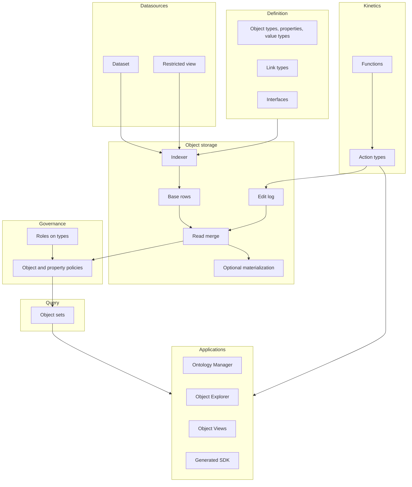
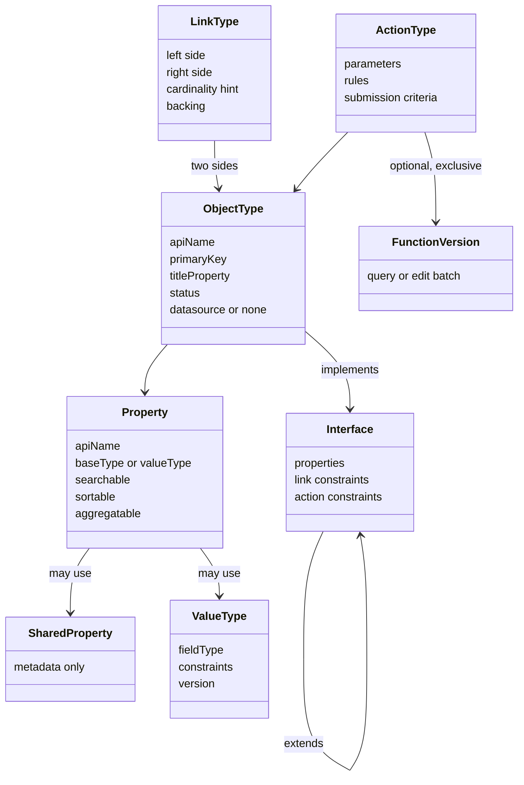
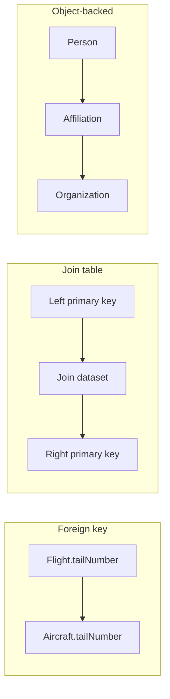
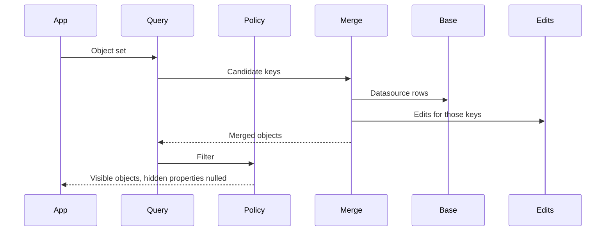
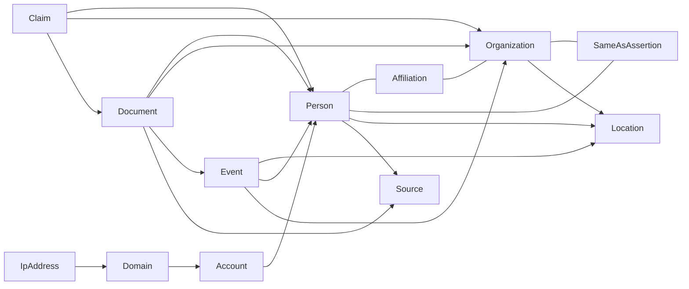
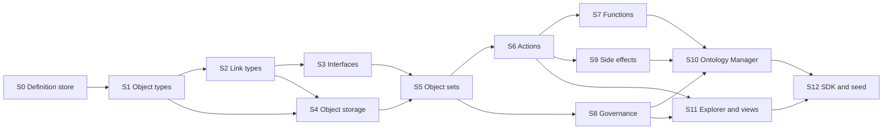

# Ontology plan

A plan for an Ontology with the same shape as Palantir Foundry’s: semantic types, a governed write path, and an object query layer that applications sit on. The first consumer is an open-source intelligence platform. The intelligence model is data in the Ontology. It is not a separate engine.

Sources for the shape of the system are the Foundry docs read on 18 Nov 2026 (America/Chicago), starting at the [Ontology overview](https://www.palantir.com/docs/foundry/ontology/overview/) and the pages linked from it. The page list is at the end.

Points below are relative engineering weight. They are not calendar time. The core plan is 13 sprints and 199 points. Remaining points hit zero when the OSINT seed is loaded.

## What Foundry’s Ontology is

The Ontology is an operational layer on top of datasets, restricted views, and models. Palantir describes it as a digital twin with two halves:

- Semantic elements: object types, properties, link types, interfaces.
- Kinetic elements: action types, functions, and dynamic security.

An object type is the schema of a real-world entity or event. An object is one instance. An object set is a collection of instances. The docs map these to a dataset, a row, and a filtered set of rows, with one difference that matters: the Ontology is what applications read and write, and user edits are part of the object, not a side file the application has to merge.

The definition is built in Ontology Manager. Reads go through object sets. Writes from people go through actions. Functions can compute values or propose edits. A function does not apply edits. An action does.

## What this plan builds

One space, one ontology, one definition format that Ontology Manager imports and exports as YAML. Applications talk to object sets and actions. They do not talk to the backing tables.

The storage model follows object storage v2, as described in the materializations docs:

- User edits are enabled on the object type. A writeback dataset is not required.
- A materialization is an optional latest snapshot for downstream jobs. History of snapshots is kept by a job that copies the snapshot, because the materialization itself only guarantees the latest state.

Object storage v1 (Phonograph) is out of scope. Docs that say a writeback dataset is required are describing v1.

Also out of the core, on purpose:

- Links that cross ontologies. Foundry does not support them. One shared ontology is the answer.
- Enforcing one-to-one cardinality. Foundry treats it as a hint.
- A second link type whose only job is to be the reverse of the first. A link type already has two sides.
- Quiver, Vertex, Map, Slate, Marketplace, and AIP as products. The object set and action APIs are the seams those products would use later.
- Multiple backing datasources on one object type, struct properties, media references, time series, vectors, and cipher text. The type catalog names them so the model can grow. The indexer implements the scalar, array, and geopoint types in the core.

## Design rules

These are the rules that keep the system Palantir-shaped. Later sprints should not break them.

1. Actions are the only write path for objects and links. A direct property update API is an action with one modify rule, or it does not exist.
2. A function that edits the Ontology returns an edit batch. Running the function in a test harness does not write. The action that names the function writes, after submission criteria pass.
3. Inside an edit function, a search or aggregation sees the index from before the batch. A fetch by primary key sees pending edits on that object. This matches the Foundry functions docs and needs a test that would fail if someone “fixes” it.
4. Foreign-key links change by editing the foreign-key property. Many-to-many links change by create-link and delete-link rules. Object-backed links change by creating or editing the backing object.
5. Rule order matters. Rules fold into one edit per object. On one property, the later rule wins. An object cannot be deleted and then written, modified and then created, or created twice in one submission.
6. A function rule cannot sit beside other rules.
7. Submission criteria are separate from the role that lets someone edit the action type. A failure returns that criterion’s message. Avoid `NOT` on group, marking, or organization membership. A scoped token can omit the attribute and the `NOT` would pass.
8. Object security policies hide the object. Property security policies null the property. The primary key is never covered by a property policy. A non-key property belongs to at most one property policy, and an object policy exists before any property policy.
9. Those policies filter reads. A copy of the data, including a materialization and an export, does not carry them. Export is a separate grant. Bulk export waits until markings exist.
10. Notifications render from the Ontology as it was before the edit, and they send after the commit. That is the Foundry behavior.

Webhook choice, stated because the docs allow either timing and do not spell out failure: a before-webhook that fails aborts the action. An after-webhook that fails is logged for retry and does not roll back the commit.

## Architecture



Definition, the edit log, and the query service are separate packages. The UI calls the query service and the action service.

Target layout when Sprint 0 starts:

```text
packages/definition    YAML schema, branch, save, audit
packages/storage       indexer, edit log, merge, materialization
packages/query         object set IR and execution
packages/actions       rules, criteria, commit
packages/functions     registry and the Python runner
packages/security      roles and policies, applied inside query
packages/sdk-gen       client generator
apps/manager           Ontology Manager
apps/explorer          Object Explorer and Object Views
seed/osint.ontology.yaml
```

Stack: TypeScript and Next.js for the services and the two apps, Postgres for definition, the edit log, and the object index. Search is Postgres (btree and trigram) behind an indexer interface, so a later move to a dedicated search engine does not change object sets. Functions run in a Python process that receives an object-set client and returns an edit batch as JSON. Analysts can write Python. The action service does not care which language produced the batch.

## Types

Foundry splits Ontology types from data types. Ontology types model the domain. Data types model values, with ideas taken from RDF, OWL, and XSD.



### Object types and properties

An object type has a display name, an API name, a description, a status (`experimental`, `active`, `deprecated`), a single primary key, and a title property. It is backed by one datasource, or by nothing when every object is created by an action.

A property has a base type or a value type, plus the flags applications need: searchable, sortable, aggregatable. Shared properties exist so `displayName` or `firstSeen` is defined once and used on many object types. The metadata is shared. The values are not.

Value types are semantic wrappers with constraints: regex, range, length, enum. They are versioned. In Foundry they belong to a space, and a space holds one ontology. This plan has one space, and value types live in it. Foundry also withholds value types from a special default ontology. There is no default ontology here, so that exception does not apply.

Base types the indexer honors in the core:

| Base type | Primary key | Title | Notes |
| --- | --- | --- | --- |
| String, integer, short | Yes | Yes | Preferred primary keys |
| Date, timestamp | Discouraged | Yes | Display and storage can collide. Prefer string keys |
| Boolean, byte, long | Discouraged | Yes | Boolean allows two objects. Long is awkward in JavaScript above 1e15 |
| Float, double, decimal | No | Yes | |
| Array of an allowed inner type | No | Only if the inner type can be a title | No null elements. No nested arrays |
| Geopoint | No | Yes | Stored as `latitude,longitude` |
| Geoshape | No | No | GeoJSON in storage |

Reserved in the catalog, implemented after the core: vector, struct, media reference, time series, geotemporal series, attachment, cipher, marking. Map and binary are not base types. Foundry excludes them.

### Link types

A link type is one relationship with two sides. Each side has a display name and an API name. From code, `flight.assignedAircraft` and `aircraft.flights` are the two sides of one link type. API names are unique among the link sides on a given object type, start with a lowercase letter, and are at most 100 characters.

Cardinality is `oneToOne`, `oneToMany`, `manyToOne`, or `manyToMany`. One-to-one is not enforced.



- Foreign key, for one-to-one and one-to-many. A property on one object type stores the primary key of the other. The link is the equality. Editing the link edits that property.
- Join table, for many-to-many. The dataset has one column for each primary key. A column maps to one side only. The product can generate an empty join table when the links will come from actions.
- Object-backed. An intermediary object type points at both sides through many-to-one links and carries the relationship’s own properties. Foundry uses this when the link needs metadata and when restricted views must apply to the link. Affiliation, with a role and dates, is this kind of link.

Several link types may connect the same pair of object types. Each one is a different relationship. A link type may connect an object type to itself.

### Interfaces

An interface describes a shape: properties, link constraints, and action constraints. It has no datasource and no instances. Object types implement it. An interface can extend several interfaces, and an object type can implement several.

Workflows that ask for `Actor` keep working when a new object type implements `Actor`. That is the reason to have interfaces in an intelligence model, where Person and Organization are both actors and new actor kinds will show up.

Interface support in Foundry is uneven across products. This plan treats interfaces as real in the definition, in object sets, in actions, and in the generated client. That is the subset the OSINT apps need.

### Actions

An action type is one transaction: parameters, rules, submission criteria, and side effects.

Parameter values can come from the caller, from a property of an object parameter, from a static value, from the current user, or from the time the action started. That timestamp stays fixed for the whole execution and can differ from the commit time in the log.

Ontology rules:

- Create object, including a primary key.
- Modify object.
- Create or modify object.
- Delete object.
- Create or delete a many-to-many link.
- The same five operations targeted at an interface, resolved to the concrete object type at submit time.
- A function rule, alone.

Create-link on a foreign key is not a rule. The modify rule sets the foreign-key property. Create object can also add many-to-many links in the same action.

Submission criteria are conditions on the current user, on parameters, combined with all / any / none. Each root condition has a failure message. A test run in Ontology Manager evaluates criteria against sample parameters and does not write.

Side effects in the core: notification, webhook. Foundry also has a schedule rule that builds a pipeline. That waits until there is a pipeline product to build.

The action log stores the actor, the parameter values, the edit batch, and the commit time.

### Functions

A published function has a version. Query functions return values or object sets. Edit functions return a batch:

```ts
type OntologyEdit =
  | { op: "create"; objectType: string; primaryKey: string; properties: Record<string, unknown> }
  | { op: "update"; objectType: string; primaryKey: string; properties: Record<string, unknown> }
  | { op: "delete"; objectType: string; primaryKey: string }
  | { op: "link"; linkType: string; fromKey: string; toKey: string }
  | { op: "unlink"; linkType: string; fromKey: string; toKey: string };
```

`link` and `unlink` are for many-to-many and for the join rows of an object-backed link. Foreign-key relationships are `update`s of the foreign-key property. The Python helper can offer `setLink` and rewrite it, so authors do not have to remember which backing they have.

The function declares which object types and link types it edits. The action uses that declaration when it checks permissions. Foundry’s `@Edits` decorator exists for this provenance.

Versions use semver. A `0.y.z` version does not auto-upgrade onto an action. From `1.0.0`, an action may pin a minimum version and take later compatible releases. Anyone who can publish the function can change what the action does, which is the security note in the Foundry docs. The default in this plan is a pin. Auto-upgrade is off unless the action owner turns it on.

### Object sets

An object set is the query. It is a value, not a list that was already loaded.

```ts
type ObjectSet =
  | { type: "base"; objectType: string }
  | { type: "interface"; interfaceType: string }
  | { type: "filter"; objectSet: ObjectSet; where: Where }
  | { type: "searchAround"; objectSet: ObjectSet; linkSide: string }
  | { type: "union" | "intersect" | "subtract"; objectSets: ObjectSet[] };

type Where =
  | { op: "eq" | "neq" | "gt" | "gte" | "lt" | "lte"; property: string; value: unknown }
  | { op: "isNull" | "isNotNull"; property: string }
  | { op: "contains"; property: string; value: string }
  | { op: "arrayContains"; property: string; value: unknown }
  | { op: "withinBBox"; property: string; minLat: number; minLon: number; maxLat: number; maxLon: number }
  | { op: "and" | "or"; clauses: Where[] }
  | { op: "not"; clause: Where };
```

Execution loads a page, sorts, projects properties, and aggregates (`count`, `sum`, `min`, `max`, grouped). Search-around walks whichever backing the link type has. An interface object set is the union of the object types that implement it, with the interface’s properties.

Nearest-neighbors waits for the vector base type.

Policies run inside execution, before rows leave the service.

### Read path



Merge rules:

- A datasource row with no edits is the object.
- An edit overrides the properties it names. Other properties stay as the datasource left them.
- A create edit with no datasource row is an object.
- A delete edit removes the object from reads.
- The search index used by filters is updated after the action commits, not inside the function.

When a datasource is replaced, save offers two migrations: drop edits, or move edits onto the new datasource. Created objects and delete edits are edits and can move. Foundry prompts for this in Ontology Manager.

### Governance

Two levels, matching the object-permissioning docs.

Ontology resources (the types) carry roles: viewer, editor, owner. Viewer can see the definition and, subject to policies, the objects. Editor changes the definition on a branch. Owner changes security policies. Creating a policy requires owner, as in Foundry.

Objects and links carry the data. Read access is:

1. Viewer on the object type.
2. The object security policy, if one is configured. Failure hides the object.
3. The mandatory-control hook. In the core this is a property whose values are marking identifiers, evaluated by an interface with one implementation: allow all. The real evaluator is an iteration.
4. Each property security policy. Failure returns null for those properties. The object stays.

A granular policy is a set of comparisons between user attributes and object properties, with an explicit weight limit of 10,000 so a policy cannot become an unbounded join. The same limit applies to an object policy combined with each single property policy. Property policies do not add to each other.

Ontology Manager includes a test that answers “what would this user see on this object?” without saving.

Datasource-derived permissions, where view access to the object also requires view access to the backing dataset, are the legacy Foundry model. This plan uses the policy on the object type so analysts can read objects without a grant on the raw collection tables.

## Applications

Ontology Manager, following the Foundry screens closely enough that the docs stay a usable manual:

- Discover, search, and create.
- Object type view: metadata, properties, actions, link graph, a data sample, dependents.
- Property editor.
- Link helper: pick foreign key, join table, or backing object, then name both sides, then save.
- Action view: overview, logic (parameters, rules, criteria), a test run, and a simple usage count.
- Interface, shared property, and value type editors.
- Branch switch. Save commits the change set on that branch. Main is the branch applications read.

Object Explorer searches and filters an object set, searches around a link side, and saves an exploration.

An object view shows the title, properties the caller may see, links, and the actions that apply to that object type. The action form posts parameters and renders submission-criteria messages.

The generated client, the OSDK equivalent, is produced for a chosen subset of types, link sides, and actions. The application token only authorizes that subset, and the user’s own policies still apply. Read-time enforcement stops at the response. The client docs should say so, in the same spirit as the Foundry OSDK page.

## OSINT seed

Sprint 12 loads this model. It is the first ontology, used to prove the mechanism, and it is ordinary definition YAML.

Interfaces:

| Interface | Required shared shape | Implemented by |
| --- | --- | --- |
| Actor | displayName, confidence | Person, Organization |
| Place | displayName, position | Location |
| Evidence | displayName, url | Document |
| Observable | value, confidence, firstSeen, lastSeen | Account, Domain, IpAddress |

Object types beyond those implementers: Event, Claim, Source, Affiliation, SameAsAssertion.

Shared properties: `displayName`, `summary`, `confidence`, `firstSeen`, `lastSeen`.

Value types: `confidence` (double, 0 to 1), `url`, `email`, `handle`, `countryCode`.



Link types:

| Link | Backing | Why this backing |
| --- | --- | --- |
| Person or Organization `locatedAt` Location | Foreign key | Many actors, one place, no metadata on the link |
| Event `occurredAt` Location | Foreign key | Same |
| Account `belongsTo` Actor | Foreign key on Account | The account holds the actor id |
| Domain `resolvesTo` IpAddress | Join table | Many-to-many, and it changes over time via edits |
| Document `mentions` Actor or Event | Join table | Many-to-many |
| Claim `attributedTo` Actor | Foreign key | One claimant side in the seed |
| Claim `supportedBy` Document | Join table | A claim can cite many documents |
| Any seeded object `derivedFrom` Source | Foreign key | Provenance of the row |
| Affiliation between Person and Organization | Object-backed | Role, validFrom, validTo live on Affiliation |
| SameAsAssertion between two Actors | Object-backed | Confidence and reviewer live on the assertion |

`validFrom` and `validTo` on Affiliation are ordinary timestamp properties in the seed. Treating intervals as a query feature of every link is an iteration, and it should extend object-backed links rather than add a second edge store.

Actions in the seed:

| Action | Rules | Criteria |
| --- | --- | --- |
| Register actor | Create object of interface Actor | Caller is in the collectors group |
| Record affiliation | Create Affiliation, which establishes the object-backed link | Both actors exist |
| Attach mention | Create many-to-many `mentions` link | Document and target exist |
| Assert claim | Create Claim, set `attributedTo`, create `supportedBy` links | Confidence parses, at least one document |
| Retract | Delete object | A reason parameter is required. The reason stays in the action log |

Merge of two actors is a function-backed action and waits until the iteration that defines entity resolution. The seed can already represent a candidate with SameAsAssertion.

Illustrative fragment of the definition format Sprint 0 freezes:

```yaml
space: osint
ontology: main
sharedProperties:
  - apiName: displayName
    baseType: string
  - apiName: confidence
    valueType: confidence
valueTypes:
  - apiName: confidence
    fieldType: double
    minimum: 0
    maximum: 1
objectTypes:
  - apiName: person
    displayName: Person
    primaryKey: personId
    titleProperty: displayName
    implements: [actor]
    properties:
      - apiName: personId
        baseType: string
      - apiName: displayName
        sharedProperty: displayName
      - apiName: confidence
        sharedProperty: confidence
    datasource:
      dataset: datasets/persons
      columns:
        personId: person_id
        displayName: name
        confidence: confidence
```

## Code sprints

Each sprint ends with the behavior in its outcome paragraph working through the API, covered by tests. The manager and the explorer are the sprints that add a UI. Earlier sprints are packages and HTTP handlers.

Dependencies are linear on purpose. Security lands before any screen shows an object. The function rule lands after declarative actions, because the action commit path has to exist before a function is allowed to use it.



### Burndown

| Boundary | Delivered in that sprint | Remaining |
| --- | ---: | ---: |
| Start | 0 | 199 |
| S0 Foundations | 13 | 186 |
| S1 Object types and properties | 21 | 165 |
| S2 Link types | 13 | 152 |
| S3 Interfaces | 8 | 144 |
| S4 Object storage | 21 | 123 |
| S5 Object sets | 21 | 102 |
| S6 Actions | 21 | 81 |
| S7 Functions | 13 | 68 |
| S8 Governance | 13 | 55 |
| S9 Side effects | 8 | 47 |
| S10 Ontology Manager | 21 | 26 |
| S11 Explorer and object views | 13 | 13 |
| S12 SDK and OSINT seed | 13 | 0 |

Where the 199 points sit:

| Layer | Sprints | Points |
| --- | --- | ---: |
| Definition | S0–S3 | 55 |
| Storage and query | S4–S5 | 42 |
| Kinetics | S6, S7, S9 | 42 |
| Governance | S8 | 13 |
| Applications | S10–S12 | 47 |

### S0 — Foundations — 13 — remaining 186

A branchable definition store and a closed type catalog. Applications still have nothing to query.

| Points | Work |
| ---: | --- |
| 2 | Stable ids, API names, display names, description, and status |
| 3 | Space, ontology, branch, and a change set that commits on Save |
| 3 | Metadata schema and migrations |
| 2 | Audit record for every definition change |
| 3 | Base type catalog and the primary-key / title-key rules, including reserved types the indexer will not honor yet |

### S1 — Object types and properties — 21 — remaining 165

An object type can be declared, mapped from one table, or left unbacked for action-created objects.

| Points | Work |
| ---: | --- |
| 5 | Object type with a single primary key and a title property |
| 5 | Properties mapped from datasource columns, with searchable, sortable, and aggregatable flags |
| 2 | Object types with no datasource |
| 3 | Shared properties. Metadata is shared. Rows are not |
| 5 | Value types with constraints, versions, and space scope |
| 1 | Object type groups for discovery |

### S2 — Link types — 13 — remaining 152

Relationships have two sides and one of three backings.

| Points | Work |
| ---: | --- |
| 3 | Link type with two named sides. API names unique per object type |
| 3 | Foreign-key links for one-to-one and one-to-many. One-to-one is stored as a hint |
| 3 | Join-table many-to-many, including a generated empty table |
| 3 | Object-backed links and the prerequisite many-to-one links |
| 1 | More than one link type between the same pair, including a type linked to itself |

### S3 — Interfaces — 8 — remaining 144

Shared shapes exist and are checked. They cannot be instantiated.

| Points | Work |
| ---: | --- |
| 3 | Interfaces that extend other interfaces, implemented by object types |
| 2 | Conformance check against properties of the implementers |
| 2 | Link constraints and action constraints declared on the interface |
| 1 | An interface-typed object set node in the definition, executed in S5 |

### S4 — Object storage — 21 — remaining 123

A read returns datasource rows merged with the edit log.

| Points | Work |
| ---: | --- |
| 5 | Batch indexer from one backing datasource into the object index |
| 5 | Edit log stored apart from datasource rows |
| 5 | Read merge: edits override named properties, creates exist only in the log, deletes tombstone |
| 2 | Search index updates after commit |
| 3 | Optional materialization of the latest merged snapshot, all properties or a subset |
| 1 | On datasource replacement, drop edits or move them |

### S5 — Object sets — 21 — remaining 102

Callers filter, traverse, combine, and aggregate without seeing the backing.

| Points | Work |
| ---: | --- |
| 5 | Object set IR: base, filter, search around, union, intersect, subtract |
| 5 | Filters: comparison, null, string contains, array contains, geopoint bounding box |
| 3 | Aggregations: count, sum, min, max, grouped |
| 2 | Sort, page, and property projection |
| 3 | Interface object sets resolved to implementing types |
| 3 | Search around foreign-key, join-table, and object-backed links |

### S6 — Actions — 21 — remaining 81

A governed transaction is the write path. The function rule is a slot that S7 fills.

| Points | Work |
| ---: | --- |
| 3 | Parameters and the five value sources: caller, object property, static, current user, action start time |
| 8 | Rules compiled to one edit per object, including the interface variants, and many-to-many links created with a new object |
| 2 | Rejection of illegal combinations: delete then write, modify then create, create twice, later write wins on one property |
| 5 | Submission criteria, logical operators, and failure messages |
| 3 | Transactional apply and the action log |

### S7 — Functions — 13 — remaining 68

Code can query and can propose edits. Only an action applies them.

| Points | Work |
| ---: | --- |
| 3 | Versioned registry and publish |
| 3 | Query functions over object sets |
| 4 | Edit functions return a batch. A direct run does not write. Fetch-by-key sees pending edits. Search does not |
| 3 | Function rule is exclusive. The edits declaration is checked against the batch. Action pins a version |

### S8 — Governance — 13 — remaining 55

Every read that returns an object has already been filtered.

| Points | Work |
| ---: | --- |
| 3 | Viewer, editor, and owner on ontology resources |
| 5 | Object security policies and property security policies, including the 10,000 comparison weight |
| 2 | Mandatory-control property hook with an allow-all evaluator |
| 2 | Enforcement inside object sets. Primary key excluded from property policies. Hidden object versus nulled property |
| 1 | Test a policy as a chosen user against a sample object |

### S9 — Side effects — 8 — remaining 47

The commit can notify people and call another system.

| Points | Work |
| ---: | --- |
| 3 | Webhooks before and after commit, with the failure rule in Design rules |
| 2 | Notifications after commit, rendered from pre-edit state |
| 2 | Usage counters for actions and functions |
| 1 | Submission-criteria test run that does not write |

### S10 — Ontology Manager — 21 — remaining 26

Builders edit the definition in a UI that follows Ontology Manager’s structure.

| Points | Work |
| ---: | --- |
| 3 | Discover, search, and create |
| 5 | Object type view and property editor |
| 3 | Link creation helper for all three backings |
| 5 | Action editor: parameters, rules, criteria, test run |
| 2 | Branch switch and save |
| 3 | Editors for interfaces, shared properties, and value types |

### S11 — Explorer and object views — 13 — remaining 13

An analyst can find an object and run an action on it. There is no unstamped bulk export on these screens.

| Points | Work |
| ---: | --- |
| 5 | Search, filter, search around, and saved explorations |
| 4 | Object view: title, visible properties, links |
| 4 | Action form, including submission-criteria failure messages |

### S12 — SDK and OSINT seed — 13 — remaining 0

A typed client and the first intelligence model. This is the end of the Palantir-shaped core.

| Points | Work |
| ---: | --- |
| 5 | Generate a client for a selected subset of types, link sides, and actions |
| 3 | Application token scoped to that subset, still subject to the caller’s policies |
| 5 | Load the OSINT seed: interfaces, object types, links, value types, and the five actions |

## After the core

These change the mechanism, or add a product on top of it. They start once remaining core points are zero. Each one should land as its own increment against the seed, which is the fixture.

| Increment | What it adds | Why it waits |
| --- | --- | --- |
| Entity resolution | Function-backed merge of two actors, using SameAsAssertion | Needs the edit-function path and a policy for who may merge |
| Temporal links | Query affiliation and identity by a valid interval | The seed already stores the timestamps. The query feature is new |
| Admiralty codes | Reliability and credibility value types required on Claim | A domain constraint on top of value types, not a new type system |
| Corroboration | Claim-to-claim support and contradiction links | Ordinary link types once the seed has been used enough to name them |
| Markings | An evaluator behind the mandatory-control hook, and export that carries the marking | The hook and the “policies do not travel” rule exist so this has a place to go |
| Scenarios | A branch of object data, and the execution-context submission criterion Foundry uses for what-if | A second data plane. The definition branch from S0 is not this |
| Vectors | Vector base type and nearest-neighbors on an object set | Search infrastructure beyond Postgres trigram |
| Workshop-style pages | Saved pages of object sets, charts, and action buttons | Explorer and actions are the runtime those pages would bind to |
| Subscriptions | A stream of commits for a saved object set | Needs a stable commit log, which the action log is |
| Multiple datasources | More than one backing datasource on an object type | Foundry’s migration limits around this are real. One datasource is enough for the seed |
| Rich base types | Struct, media reference, time series, cipher | Named in the catalog so properties can adopt them without a new type system |
| Derived properties | A query function registered as a property | Object views can call the function before a property needs to |

## Documentation this plan is drawn from

- [Ontology overview](https://www.palantir.com/docs/foundry/ontology/overview/)
- [Object types](https://www.palantir.com/docs/foundry/object-link-types/object-types-overview)
- [Properties](https://www.palantir.com/docs/foundry/object-link-types/properties-overview) and [base types](https://www.palantir.com/docs/foundry/object-link-types/base-types)
- [Types reference](https://www.palantir.com/docs/foundry/object-link-types/type-reference)
- [Shared properties](https://www.palantir.com/docs/foundry/object-link-types/shared-property-overview)
- [Value types](https://www.palantir.com/docs/foundry/object-link-types/value-types-overview)
- [Link types](https://www.palantir.com/docs/foundry/object-link-types/link-types-overview) and [create a link type](https://www.palantir.com/docs/foundry/object-link-types/create-link-type)
- [Interfaces](https://www.palantir.com/docs/foundry/interfaces/interface-overview)
- [Action types](https://www.palantir.com/docs/foundry/action-types/overview), [rules](https://www.palantir.com/docs/foundry/action-types/rules), and [submission criteria](https://www.palantir.com/docs/foundry/action-types/submission-criteria)
- [Functions](https://www.palantir.com/docs/foundry/functions/overview) and [Ontology edits](https://www.palantir.com/docs/foundry/functions/edits-overview)
- [Ontology Manager](https://www.palantir.com/docs/foundry/ontology-manager/overview)
- [Object permissioning](https://www.palantir.com/docs/foundry/object-permissioning/overview) and [object and property security policies](https://www.palantir.com/docs/foundry/object-permissioning/object-security-policies)
- [Ontology SDK](https://www.palantir.com/docs/foundry/ontology-sdk/overview)
- [Object sets](https://www.palantir.com/docs/foundry/api/v2/ontologies-v2-resources/ontology-object-sets/ontology-object-set-basics)
- Object edits and materializations, for the v1 writeback versus v2 edit-log distinction
